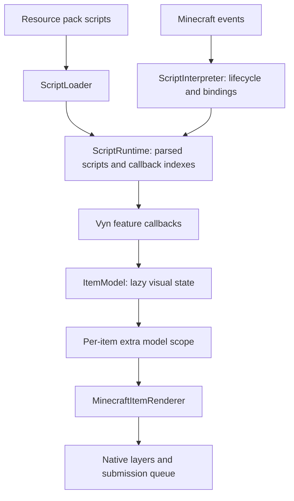

# InteractiveStuff project map

Updated 2026-10-10 for the shared overhaul and six version targets. The original checkout's uncommitted 26.3 edits are preserved separately.

## Product and build

InteractiveStuff is a client-only Fabric mod. Minecraft events enter Java adapters, which dispatch Vyn callbacks from resource packs. Scripts modify temporary visual item models and create extra models; Minecraft's native renderer draws them. The mod does not change inventory contents or add networking.

The shared base targets Minecraft 26.2, Fabric Loader 0.19.5, Fabric API 0.158.0+26.2, Java 25 and Loom 1.17.19. Six version profiles under `versions/` select native adapters, dependencies and Java 21/25 release levels. Mod Menu 20.0.1 and YACL 3.9.6+26.2-fabric are optional integrations. The normal mod JAR bundles the local `libs/Vyn.jar` interpreter. The source JAR and client test mod are separate.

## System ownership

Paths are relative to `src/main/java/omar/projects/interactivestuff`.

| Area | Files | Responsibility |
| --- | --- | --- |
| Entry points | `IS`, `ISClient` | Load config, register the default resource pack, install client handlers |
| Scheduler core | `runtime/TickScheduler` | Deterministic delayed/repeating tasks, cancellation, pause/resume and reentrant callbacks |
| Scheduler adapter | `handlers/BackgroundLoopHandler` | Advance tasks on unpaused client ticks while a world exists |
| Timing core | `runtime/FrameClock` | Monotonic nanosecond deltas, pause handling, 50ms stall cap and frame IDs |
| Timing adapter | `scripts/Utilities/RenderTickHandler`, `mixin/render/GameRendererMixin` | Begin one frame and expose normalized delta |
| Script core | `scripts/ScriptRuntime`, `scripts/objects/Script`, `PackScripts` | Cache parsed ASTs, load libraries, manage states, index callbacks and item filters |
| Deferred ownership | `scripts/ScriptExecutionContext`, `WaitStatement`, `WaitHandler` | Retain a wait's environment and owner; reject work after reload; isolate callback failures |
| Resources | `scripts/ScriptLoader` | Discover full relative script paths and preserve resource-pack priority |
| Client API boundary | `compat/MinecraftAccess` | Keep client, player-state and biome API differences outside shared bindings |
| Minecraft bindings | `scripts/ScriptInterpreter`, `scripts/variables/*` | Live player/world views, native types/functions, client-thread event dispatch and session cleanup |
| Extra models | `scripts/Utilities/ItemModelRenderRegistry` | Scope models to one rendered item, inherit actual hand, assign stable seeds, close safely |
| Visual state | `scripts/variables/ItemModel` | Transform, hierarchy, tint, lighting, glint, quad selection and stack copy-on-mutation |
| Rendering core | `render/ColorMath`, `QuadSelection` | ARGB multiplication and clamped half-open selection ranges |
| Rendering adapter | `render/MinecraftItemRenderer`, `ColoredQuadCache`, `RenderTransforms` | Resolve layers, preserve native transforms/special renderers, remap tint slots, bounded geometry cache |
| Particle core | `particles/ParticleSystem`, `ParticleStyle`, `ParticleCurve`, `scripts/variables/ParticleEmitter`, `Particle` | Tick-based emitter channels, immutable birth settings, easing/keyframes, Vyn callbacks, caps and owner cleanup |
| Particle renderer | `render/ParticleTextures`, `ParticleGeometry`, `MinecraftParticleRenderer`, `FirstPersonParticleMixin` | Resource-pack PNG/frame lookup and camera-facing first-person geometry, batched by texture/depth |
| Render mixins | `HeldItemRendererMixin`, `ItemRenderStateAccessor`, `ItemRenderStateLayerAccessor` | Enter first-person rendering and access version-specific native layer APIs |
| Interaction | `handlers/InteractionHandler`, `objects/InteractionMaterial`, `mixin/player/ArmSwingMixin` | Swing callbacks, hit-sound cooldown, material lookup and target exclusions |
| Camera motion | `mixin/player/CameraMixin`, `handlers/CameraVelocityAccessor` | Wrapped yaw deltas and time-scaled smoothing |
| Config | `handlers/config/*`, `scripts/variables/InteractiveStuffConfig` | JSON defaults/persistence, immediate cache refresh, script settings and optional Mod Menu UI |
| Components | `scripts/Utilities/ScriptItemHandler` | SNBT parsing and registry-aware component codecs |
| Debug | `scripts/handlers/DebugTextHandler`, `functions/DebugText`, `MinecraftClientMixin`, `InGameHudMixin`, `objects/PivotRendererBlock` | Publish debug snapshots and optional pivot models |
| Input/audio | `mixin/client/KeyboardMixin`, `mixin/sound/SoundListenerMixin` | Key-down events in the world and observed sounds |

The scheduler, frame clock and script core do not depend on Minecraft classes. Vyn remains the script interpreter; there is no replacement language or dependency upgrade.

## Lifecycle and event contract

Resource reload clears callbacks, deferred tasks, frame timing, extra render scopes, debug output and colored geometry. The loader sorts scripts by full relative path inside packs and loads packs in resource-manager order. All scripts reset before any script loads, so exclusion is not undone by a later load.

Joining a world or changing dimensions refreshes the player/living entity and live world views, clears session work and resets script globals. Respawn updates the player reference. Disconnect clears readiness and scheduled work. Sound events arriving off the client thread are queued with a session generation guard.

| Callback | Trigger | Arguments |
| --- | --- | --- |
| `onTick` | Unpaused client tick with player/world | None |
| `onItemUpdate` | Local first-person item rendering, filtered by item ID | Temporary `ItemModel` |
| `onSwingHand` | Local swing, independently of Java sound cooldown | None |
| `onPlaySound` | Observed non-UI/non-ambient playback, dispatched on client thread | `Sound` |
| `onKeyPress` | Key-down with a world and no menu screen | Integer input |

A callback error disables that script until the next reload/session reset. A deferred error also disables its owner. Sound wrappers describe a playback event; editing them does not alter the already-playing sound.

Scripts may declare `lock interactiveItems = ["minecraft:chest"]`. This restricts only `onItemUpdate`. Omission preserves all-item dispatch for existing packs. Lists of matching scripts are memoized by registered item ID. Callback existence/state is checked before native object binding.

## Script states and imports

States are `UNLOADED → LOADING → LOADED` for scripts with recognized callbacks, or `IMPORTABLE` for libraries. `ERROR` and `EXCLUDED` stop dispatch.

`importScript(packId, relativeName)` loads a callback-free library synchronously and executes its cached AST in the caller's environment. Circular imports, missing libraries and imports of callback scripts fail immediately. A unique basename alias remains supported; ambiguous aliases require the full relative path. Importing a library creates caller-local globals, preserving the existing physics library model.

`excludeScript(packId, relativeName)` disables a script. Resource-pack priority and lexical script order determine composition; they are explicit rather than hash-map iteration order.

`wait ticks do ... end` creates an independent one-shot task even when another wait has the same duration. Zero/negative delay executes on the next tick. Named Java waits still deduplicate by name for cooldowns. Paused loops retain their remaining delay.

## Rendering contract

The held-item mixin skips unrelated items before constructing a visual wrapper. A render scope owns any extra models created by callbacks. If scripts create extras without modifying the primary, vanilla still draws the primary. Closing a scope clears extras even if rendering fails.

`ItemModel` lazily allocates its quaternion, tint map and shear matrix. Visual edits mark the model modified without copying its stack. Component/model changes first copy the stack. `copy()` clones visual properties and tint/rotation state; subsequent component edits detach its stack independently.

Main/off-hand identity uses both the display side and the player's dominant arm; physical left/right identity uses only the render side. Mirrored angles in bundled scripts use `isLeftHand()`/`isRightHand()`. Extra models inherit both identities. Resolver seeds use stable slots within a render, avoiding per-frame random model changes.

For full models without color changes, the adapter uses native state submission. Partial or colored baked layers use native layer transforms, preserving local transforms and foil. Colors are indexed by material tint index. Untinted quads receive a dedicated slot; explicit script tints override native tint and color multipliers compose with the remaining native color. Recolored geometry is immutable, bounded to 128 cached layouts, and invalidated on resource reload. Per-submission tint arrays and render states remain separate because Minecraft queues them for later consumption.

Special renderers remain native, including in the partial/color path. Generic quad selection and tint changes apply to baked geometry; native shield/chest/banner renderer geometry cannot be split or recolored by that quad API.

`select(start, end)` is exclusive. `setQuads(start, end)` preserves unselected complements. Ranges are half-open; end zero means through the final quad. The matrix/color config toggles are honored. Packed sky/block light uses offsets 20 and 4.

## First-person particle contract

[The Vyn particle API](VYN_PARTICLES.md) binds persistent emitter objects to models inside the item-render scope. Anchors include script/native transforms and are resolved once per model per scope. Main/off-hand channels snapshot independent styles and rates. Tick-based emission uses held-item validation plus render-frame bindings, so it remains active below 20 FPS. Existing particles finish at the last anchor unless scripts request immediate clearing.

Detached particles live in view coordinates; attached particles follow the current model anchor. The separate hand-pass tail draws immutable camera-facing geometry snapshots, batched by texture/depth, even after an item switches. Native adapters account for whether the queue is consumed before or after camera restoration; the immediate 1.21.5 adapter flushes inside the hand pass. The system never uses Minecraft world particle spawning. Session/resource reload releases particles, emitters and texture caches.

## Bundled features

The resource pack remains at `src/main/resources/resourcepacks/interactive_resourcepack`.

| Script | Features |
| --- | --- |
| `chests.vyn` | Chest, trapped/ender chest and all copper/waxed copper chest variants |
| `enchanting_table.vyn` | Opening book halves; cached nearby bookshelf query |
| `itemframes.vyn` | Item/glow frames, painting and hanging signs with physics |
| `leaves.vyn` | Five supported leaves and grass tint behavior |
| `mace.vyn` | Mace motion and fall lean |
| `pistons.vyn` | Piston/sticky piston extension and sounds |
| `redstone_items.vyn` | Redstone lamp and torch interaction |
| `sapling.vyn` | Five supported saplings with separate wood/leaves |
| `sculk_sensors.vyn` | Normal/calibrated sensor sound response and independent cooldowns |
| `torches_and_more.vyn` | Torch/campfire family extinguishing/relighting |
| `totem.vyn` | Totem visual effects |
| `vault.vyn` | Cycling vault contents |
| `water_bucket.vyn` | Bucket/water split model and biome water tint |
| `note_block.vyn` | Crouch melody and instrument interaction |
| `physics_lib.vyn` | Caller-local spring state; one integration per frame ID |
| `debug.vyn` | Debug overlay with early disabled-mode exit and nullable getter guards |

Custom models live under `assets/interactivestuff/items` and `models/item`; textures under `textures/item`. Minecraft model overrides and Punchy compatibility JSON remain separate. Custom model particle references now resolve.

## Verification and future work

`./gradlew build26_2` includes deterministic runtime/render/particle regression checks from `src/regression`. `./gradlew test26_2` uses a separate `src/gametest` mod and `build/26.2/26.2/run/clientGameTest`, exercises actual Minecraft rendering/lifecycle, and exits automatically. It requires a graphics display; it is not required by the ordinary headless build. `buildAll` and `testAll` run the respective checks for all eight releases.

See [26.2_OVERHAUL.md](26.2_OVERHAUL.md) for changes, evidence and limits, and [VERSION_PORTING.md](VERSION_PORTING.md) for the version boundary.

The current adapter layout and build commands are documented in [VERSION_PORTING.md](VERSION_PORTING.md). All versions share the `main` development branch; see [REPOSITORY_WORKFLOW.md](REPOSITORY_WORKFLOW.md). Latest per-version evidence is in [MULTIVERSION_VALIDATION.md](MULTIVERSION_VALIDATION.md).
